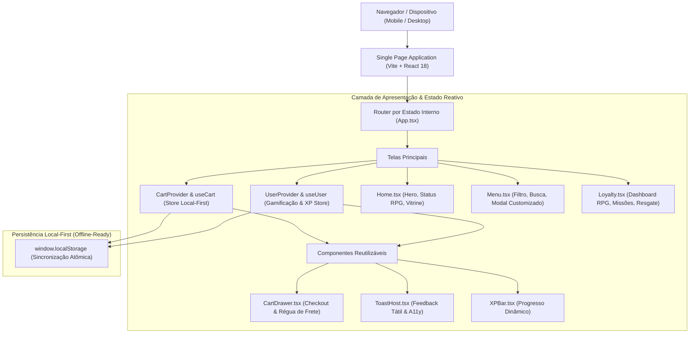

# 🍔 byte.burger — Deploy de Sabor, Commit de Fidelidade

[](https://react.dev)
[](https://www.typescriptlang.org)
[](https://vitejs.dev)
[](https://tailwindcss.com)
[](https://vitest.dev)
[]()
[](LICENSE)
[]()

> **A plataforma de e-commerce e fidelidade temática criada por quem entende de código.**  
> O `byte.burger` combina a experiência transacional de delivery gastronômico com mecânicas de progressão de RPG, transformando cada pedido em pontos de experiência (XP) que elevam a carreira do cliente de *Estagiário* a *Arquiteto de Sistemas*. Construído com foco em performance pura a 60 FPS, microinterações táteis, acessibilidade (WCAG 2.1 AA) e persistência offline Local-First.

---

## ⚡ Quickstart em 3 Passos

```bash
# 1. Clonar o repositório
git clone https://github.com/kazuhirokamim/byte.burger.git
cd byte.burger

# 2. Instalar dependências
npm install

# 3. Iniciar o servidor de desenvolvimento
npm run dev
```

Acesse em seu navegador em `http://localhost:5173`.

---

## 🧪 Suíte de Testes Automatizada

O projeto conta com suíte de testes unitários e de integração via **Vitest** + **Testing Library**, cobrindo regras de negócio, persistência de carrinho e cálculo de gamificação (happy path, casos de borda e tratamento de erros):

```bash
# Executar todos os testes
npm test

# Executar testes em modo watch
npm run test:watch

# Checar tipos estritos do TypeScript
npm run typecheck

# Gerar build de produção otimizado
npm run build
```

---

## 🏛️ Visão Geral da Arquitetura



---

## 🚀 Funcionalidades Principais

- **🍔 Cardápio Dinâmico e Customizável**: Filtros por categoria em chips táteis, busca instantânea e modal de customização de ponto da carne e adicionais com cálculo reativo de preço e XP.
- **🛒 Carrinho Deslizante com Régua de Frete**: Indicador visual dinâmico para frete grátis, incremento/decremento atômico de itens e checkout simulado com geração de histórico.
- **🎮 Gamificação RPG Completa**:
  - 5 Níveis de Carreira: *Estagiário* → *Dev Júnior* → *Dev Pleno* → *Dev Sênior* → *Arquiteto*.
  - Missões Diárias e Semanais que concedem XP e moedas de fidelidade.
  - Catálogo de Resgate de Recompensas por degraus de raridade (Comum, Raro, Épico e Secreto).
- **💾 Local-First & Zero Backend Inicial**: Todos os dados de pedidos, XP e missões são persistidos com segurança no `localStorage` do dispositivo.
- **♿ Acessibilidade WCAG 2.1 AA**: Fechamento de modais via tecla `Escape`, leitores de tela com `role="dialog"` / `aria-modal="true"` e feedback sonoro/visual via `role="status"`.

---

## 📁 Estrutura de Diretórios

```
byte.burger/
├── docs/                           # Planos SDD 2.0 e Decisões de Arquitetura (MADR)
│   ├── adr/                        # ADR-001 a ADR-004 (Local-First Engine)
│   └── plans/                      # PLAN-01-pwa-local-first.md
├── documentation/                  # Acervo Técnico e Laudos Forenses
│   ├── academico/                  # Artigo IEEE/SBC, Dossiê 90/10 e Blueprint de Frontend
│   ├── auditorias/                 # Laudo Pericial Forense Completo
│   └── showcase/                   # Vitrine GitHub e Post de Liderança LinkedIn
├── src/
│   ├── components/                 # Componentes de UI (Navbar, CartDrawer, ToastHost, etc.)
│   ├── data/                       # Catálogo de produtos, níveis e missões (+ testes)
│   ├── lib/                        # Utilitários de formatação de moeda e XP (+ testes)
│   ├── pages/                      # Views (Home, Menu, Loyalty)
│   ├── store/                      # Stores reativas com persistência (cart, user + testes)
│   ├── types/                      # Tipagem estrita TypeScript
│   ├── App.tsx                     # Roteamento e orquestração do layout
│   ├── index.css                   # Tokens de design system, glassmorphism e animações
│   └── main.tsx                    # Entrypoint da aplicação React
├── tailwind.config.js              # Paletas ink/ember/flame e keyframes de movimento
├── tsconfig.app.json               # Configurações do compilador TypeScript com Vitest
└── vite.config.ts                  # Bundler Vite e runner de testes Vitest
```

---

## 📜 Licença

Distribuído sob a licença **MIT**. Consulte `LICENSE` para mais informações.
