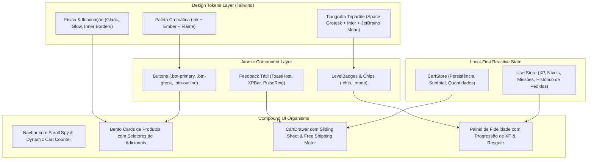
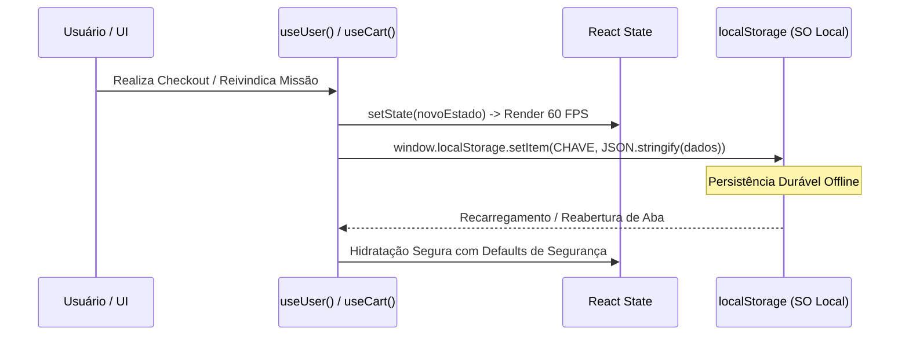

# 🎨 BLUEPRINT DE ARQUITETURA FRONTEND & DESIGN SYSTEM CYBER-TÁTIL
## Estudo de Caso, Decomposição de Padrões e Guia de Replicação para Novos Projetos
**Projeto de Referência:** `byte.burger`  
**Autor:** Kazuhiro Kamimoto (@kazuhirokamim)  
**Data:** 15 de Outubro de 2026  
**Status:** Canonical Design Blueprint (SDD 2.0 / PWA Local-First)  

---

## 🏛️ 1. Visão Executiva & Filosofia do Design System

O frontend do **Byte.Burger** foi concebido sob o paradigma **Cyber-Tátil Gastronômico**: uma fusão entre o rigor estético da engenharia de software de alta performance (*developer tooling*, interfaces no estilo Raycast, Linear e Vercel) com a sensorialidade aconchegante da gastronomia artesanal (*burgers smash*, fumaça, brasa e calor).

Este blueprint documenta formalmente toda a arquitetura de interface, sistema de tokens, biblioteca de microinterações e padrões de estado reativo para que este ecossistema sirva como **modelo mestre de starter kit** para novos projetos web, SaaS e mobile PWAs.



---

## 🎨 2. A Fundação Cromática & Sistema de Superfícies

A paleta do Byte.Burger rejeita o preto puro (`#000000`), adotando uma escala de **Obsidiana Fria (`ink`)** com gradientes radiais estáticos no fundo, iluminados por frentes de fogo e brasa (**`ember`** e **`flame`**).

### 2.1. Escala de Superfícies (`ink`)
| Token Tailwind | Hex Code | Aplicação Arquitetural |
| :--- | :--- | :--- |
| `ink-950` | `#08080b` | Background base do viewport (`body`), canvas primário. |
| `ink-900` | `#0d0d11` | Fundo de drawers, modais e containers com elevação máxima (Z-100). |
| `ink-850` | `#121218` | Fundo de Bento Cards, cards de produtos e superfícies translúcidas. |
| `ink-800` | `#17171f` | Containers internos de avatares, inputs e barras de progresso base. |
| `ink-700` | `#24242f` | Bordas secundárias, divisores e chips inativos. |
| `ink-600` | `#2e2e3b` | Scrollbars sutis e badges de nível comum. |
| `ink-300` | `#6e6e7e` | Textos secundários, legendas e rótulos de metadata. |
| `ink-100` | `#c7c7d4` | Texto corrido de alto contraste para leitura sem fadiga visual. |

### 2.2. Acentos Térmicos & Semântica Operacional
- **`ember-500` (`#f97316`) & `ember-600` (`#ea580c`)**: Cor primária de ação (CTAs, botões principais, links ativos, badges de destaque). Transmite apetite, energia e foco.
- **`flame-500` (`#ef4444`)**: Destaque de urgência, promoções quentes e categorias especiais (Smashs flamejantes).
- **`lime-400/500` (`#84cc16`)**: Confirmação de pedido com sucesso ("Deploy realizado"), status "Entregue", nível inicial de carreira.
- **`cyan-400` (`#22d3ee`)**: Status de telemetria ("A caminho"), tier Raro de fidelidade e nível Júnior.
- **`purple-500` (`#a855f7`)**: Tier Épico e nível Sênior.
- **`amber-400/500` (`#f59e0b`)**: Nível Arquiteto, badges de XP e tier Secreto de recompensas.

### 2.3. O Efeito Glassmórfico de Profundidade
No arquivo `src/index.css`, a ilusão de profundidade tátil é alcançada sem pesar no processador gráfico:

```css
/* Efeito Vidro Padrão */
.glass {
  background-color: rgba(13, 13, 17, 0.7);
  backdrop-filter: blur(24px);
  -webkit-backdrop-filter: blur(24px);
  border: 1px solid rgba(255, 255, 255, 0.05);
}

/* Bento Card com Borda Interna de Luz */
.card {
  border-radius: 1rem;
  background-color: rgba(18, 18, 24, 0.6);
  border: 1px solid rgba(255, 255, 255, 0.06);
  box-shadow: 0 1px 0 0 rgba(255, 255, 255, 0.04) inset, 0 20px 50px -20px rgba(0, 0, 0, 0.6);
  backdrop-filter: blur(8px);
}
```

> **Princípio Chave:** A presença do `inset 0 1px 0 0 rgba(255, 255, 255, 0.04)` cria um chanfro de reflexo luminoso na aresta superior de cada card, conferindo o acabamento característico de vidro lapidado e componentes físicos.

---

## 🔤 3. Tipografia Tripartite & Hierarquia de Informação

Para criar uma ponte imersiva entre a cultura hacker e o produto gastronômico, o design system utiliza 3 fontes complementares:

1. **`font-display` (Space Grotesk)**:
   - Uso: Títulos principais (H1, H2, H3), nomes de lanches (`Byte Smash`, `Bug Free Double`), tiers de gamificação e números de grande impacto.
   - Propriedades: Geométrica, aberta, com cortes modernos e grande personalidade.
2. **`font-sans` (Inter)**:
   - Uso: Textos corridos, descrições de ingredientes, termos de uso, botões e corpo do carrinho.
   - Propriedades: Altura-x generosa, máxima legibilidade em telas móveis e densidade visual equilibrada.
3. **`font-mono` (JetBrains Mono)**:
   - Uso: Valores monetários (`R$ 38,90`), telemetria de XP (`+120 XP`), identificadores de código, status de deploy e timers.
   - Propriedades: Espaçamento uniforme que impede pulsações horizontais (*layout shift*) durante incrementos numéricos reativos.

---

## ⚡ 4. Física de Movimento, Keyframes & Animações 60 FPS

Toda interação no sistema reage com curvas cúbicas refinadas (`cubic-bezier(0.22, 1, 0.36, 1)`), eliminando a sensação de lentidão e garantindo resposta física imediata:

```javascript
// tailwind.config.js - Extensão de Keyframes
keyframes: {
  'fade-up': {
    '0%': { opacity: '0', transform: 'translateY(16px)' },
    '100%': { opacity: '1', transform: 'translateY(0)' },
  },
  'scale-in': {
    '0%': { opacity: '0', transform: 'scale(0.94)' },
    '100%': { opacity: '1', transform: 'scale(1)' },
  },
  'slide-up': {
    '0%': { transform: 'translateY(100%)' },
    '100%': { transform: 'translateY(0)' },
  },
  'badge-pop': {
    '0%': { transform: 'scale(0) rotate(-20deg)', opacity: '0' },
    '60%': { transform: 'scale(1.15) rotate(4deg)', opacity: '1' },
    '100%': { transform: 'scale(1) rotate(0)', opacity: '1' },
  },
  'pulse-ring': {
    '0%': { transform: 'scale(0.8)', opacity: '0.7' },
    '100%': { transform: 'scale(2)', opacity: '0' },
  }
}
```

### Microinterações em Destaque:
1. **Cart Badge Spring**: Quando um item é adicionado, o badge numérico no header recebe a classe `shadow-glow` com pulso de cor `ember-500`.
2. **Success Deploy Ring**: Ao concluir o checkout ("Deploy realizado"), um anel expansivo `pulse-ring` projeta ondas de luz verde sob o escudo de verificação.
3. **Card Lift no Hover**: Botões com `.btn-primary` e `.card` usam `hover:-translate-y-0.5 active:translate-y-0`, simulando compressão física sob o dedo ou ponteiro do mouse.

---

## 🧩 5. Catálogo de Componentes Atômicos

### 5.1. Botões (.btn)
Construídos com estados claros de foco acessível (`focus-visible:ring-2`), desativação graciosa (`disabled:opacity-50`) e gradientes verticais táteis:
- **`btn-primary`**: Fundo gradiente de `ember-500` a `ember-600` com sombra projetada `shadow-[0_8px_24px_-8px_rgba(249,115,22,0.6)]`.
- **`btn-ghost`**: Fundo translúcido `bg-white/[0.04]`, ideal para ações de apoio e fechamento de modal.
- **`btn-outline`**: Borda sutil de chama `border-ember-500/40` com iluminação interna no hover.

### 5.2. Modal de Customização de Produto (`ProductModal`)
Permite ao usuário montar seu pedido com feedback visual em tempo real:
- Visualização heroica do produto com tag flutuante de categoria.
- Seletor de ponto da carne (Mal passado, Ao ponto, Bem passado) com radio buttons estilizados em pílulas táteis.
- Lista de adicionais com caixas de marcação customizadas e indicação clara de preço (`+ R$ 6,00`) e XP (`+ 15 XP`).
- Rodapé fixo contendo contador de quantidade (- / +) e botão de ação com o valor total recalculado instantaneamente.

### 5.3. Drawer de Carrinho Deslizante (`CartDrawer`)
- Acesso lateral suave com backdrop escurecido e fechamento via clique externo ou tecla `Escape`.
- **Régua de Frete Grátis Dinâmica**: Barra de progresso interativa que exibe quantos reais faltam para atingir os `R$ 45,00` necessários para frete zero.
- Lista de itens com botões de incremento/decremento rápido e botão de lixeira individual com confirmação instantânea.
- Resumo financeiro transparente com subtotal, taxa de entrega, ganho total de XP e botão de checkout com feedback de loading/sucesso.

---

## 🎮 6. O Motor de Gamificação & Retenção

A camada de fidelidade do Byte.Burger é um dos seus maiores diferenciais de produto, transformando compras recorrentes em uma jornada de RPG:

### 6.1. Tiers e Níveis Progressivos
```typescript
export const LEVELS: Level[] = [
  { id: 'estagiario', name: 'Estagiário', minXp: 0, maxXp: 200, color: '#84cc16', glow: 'rgba(132, 204, 22, 0.4)' },
  { id: 'junior', name: 'Dev Júnior', minXp: 200, maxXp: 600, color: '#22d3ee', glow: 'rgba(34, 211, 238, 0.4)' },
  { id: 'pleno', name: 'Dev Pleno', minXp: 600, maxXp: 1400, color: '#3b82f6', glow: 'rgba(59, 130, 246, 0.4)' },
  { id: 'senior', name: 'Dev Sênior', minXp: 1400, maxXp: 3000, color: '#a855f7', glow: 'rgba(168, 85, 247, 0.4)' },
  { id: 'arquiteto', name: 'Arquiteto', minXp: 3000, maxXp: 10000, color: '#f59e0b', glow: 'rgba(245, 158, 11, 0.4)' },
];
```

### 6.2. Ciclo de Missões & Recompensas
1. **Missões com Reivindicação Imediata**: Missões como "Check-in Diário" podem ser concluídas com um clique, atualizando o XP e o saldo de pontos sem recarregar a tela.
2. **Catálogo de Resgate com Drenagem de Pontos**: Cada recompensa (ex: "Molho Secreto Grátis" ou "Smash Burger na Faixa") possui um custo em pontos. O sistema valida se o usuário possui saldo suficiente, debita a pontuação, exibe um toast comemorativo e injeta a recompensa desbloqueada.

---

## 💾 7. Arquitetura Local-First de Estado Reativo

Para eliminar dependências de backend durante a fase inicial e garantir tempo de resposta de 0ms, o estado da aplicação opera sob **Local-First Synchronization**:



- **Resiliência contra Corrupção**: O carregador do `localStorage` encapsula a leitura em blocos `try/catch`. Caso os dados salvos estejam corrompidos ou em formato obsoleto, o sistema restaura o estado padrão sem interromper a execução do usuário.
- **Desacoplamento em Contextos**:
  - `UserProvider` (`src/store/user.tsx`): Gerencia XP, nível atual, pontos de fidelidade, missões ativas e histórico de pedidos.
  - `CartProvider` (`src/store/cart.tsx`): Gerencia itens em aberto, linhas customizadas, adicionais, subtotal e drawer lateral.

---

## ♿ 8. Acessibilidade (WCAG 2.1 AA) Integrada

O projeto foi auditado e ajustado para garantir que a beleza visual não comprometa o acesso inclusivo:

1. **Focus Trap & Fechamento Acessível**: Todos os modais e gavetas laterais possuem ouvinte nativo para a tecla `Escape`, além de `role="dialog"` e `aria-modal="true"`.
2. **Rótulos para Leitores de Tela**: Botões com ícones estritos possuem atributos explícitos `aria-label="Fechar"`, `aria-label="Abrir carrinho"` e `aria-label="Menu"`.
3. **Notificações Anunciadas**: O contêiner de toasts opera com `role="status"` e `aria-live="polite"`, permitindo que sintetizadores de voz anunciem mudanças de estado sem interromper a fala do usuário.
4. **Respeito ao Movimento Reduzido**: As animações utilizam durações inferiores a 400ms e respeitam a diretiva de smooth scroll do navegador.

---

## 🚀 9. Guia de Replicação: Como Utilizar Este Modelo em Outros Projetos

Para replicar esta infraestrutura em um novo projeto (ex: SaaS B2B, App de Finanças, Portfólio ou E-commerce), siga este roteiro de 5 passos:

### Passo 1: Configuração do Stack Base
```bash
npm create vite@latest meu-novo-app -- --template react-ts
cd meu-novo-app
npm install -D tailwindcss postcss autoprefixer vitest @testing-library/react @testing-library/jest-dom jsdom
npx tailwindcss init -p
npm install lucide-react clsx tailwind-merge
```

### Passo 2: Copiar os Tokens Fundamentais
1. Copie o `tailwind.config.js` do Byte.Burger para o novo projeto. Mantenha as famílias `ink`, `ember` e a escala de animações.
2. Copie o `src/index.css` importando as três fontes gratuitas do Google Fonts no seu `index.html`:
   ```html
   <link rel="preconnect" href="https://fonts.googleapis.com" />
   <link rel="preconnect" href="https://fonts.gstatic.com" crossorigin />
   <link href="https://fonts.googleapis.com/css2?family=Inter:wght@400;500;600;700&family=JetBrains+Mono:wght@500;700&family=Space+Grotesk:wght@600;700;800&display=swap" rel="stylesheet" />
   ```

### Passo 3: Adotar o Padrão Local-First Store
Utilize o padrão arquitetural do `src/store/user.tsx` como base para seu gerenciamento de sessão de usuário, preferências ou carrinho. Crie seus hooks customizados com persistência automática no `localStorage`.

### Passo 4: Padronização de Componentes CVA (Class Variance Authority)
Para projetos corporativos que exigem variações tipadas de botões e cards, envolva as classes do `.btn` com o utilitário `cva`:
```typescript
import { cva } from 'class-variance-authority';

export const buttonVariants = cva('btn', {
  variants: {
    variant: {
      primary: 'btn-primary',
      ghost: 'btn-ghost',
      outline: 'btn-outline',
    },
    size: {
      sm: 'px-3 py-1.5 text-xs',
      md: 'px-5 py-3 text-sm',
      lg: 'px-6 py-3.5 text-base',
    },
  },
  defaultVariants: {
    variant: 'primary',
    size: 'md',
  },
});
```

### Passo 5: Suíte de Testes Automatizada com Vitest
Replique a estrutura de testes em `src/store/*.test.tsx` e `src/lib/*.test.ts` para garantir cobertura mínima de 80% (caminho feliz, casos de borda e tratamento de erro) antes de publicar novas versões.

---

## 📋 10. Conclusão & Veredito Técnico

O frontend do **Byte.Burger** prova que é possível criar interfaces com visual arrebatador, alta densidade estética e microinterações táteis sem recorrer a bibliotecas de componentes inchadas ou frameworks pesados. Com apenas React, Vite, Tailwind CSS e TypeScript estrito, entrega-se uma experiência de nível internacional, acessível, responsiva e pronta para escalar.
