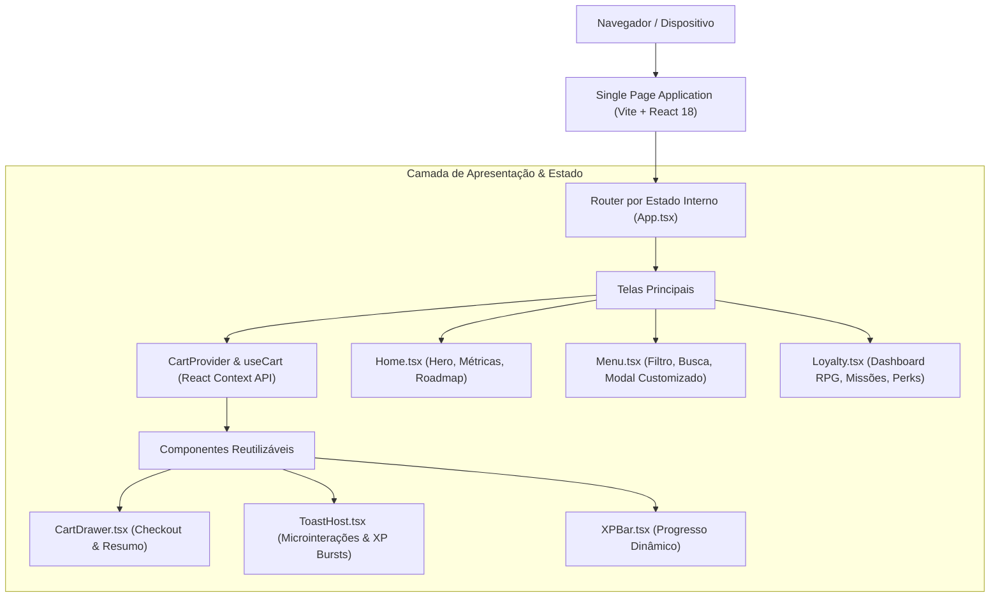

# 🍔 byte.burger — Deploy de Sabor, Commit de Fidelidade

[](https://react.dev)
[](https://www.typescriptlang.org)
[](https://vitejs.dev)
[](https://tailwindcss.com)
[](LICENSE)
[]()

> **A plataforma de e-commerce e fidelidade temática criada por quem entende de código.**  
> O `byte.burger` combina a experiência transacional de delivery gastronômico com mecânicas de progressão de RPG, transformando cada pedido em pontos de experiência (XP) que elevam a carreira do cliente de *Estagiário* a *Arquiteto de Sistemas*. Construído com foco em performance pura a 60 FPS, microinterações hápticas e design system dark moderno com estética ember/cyber-tátil.

---

## ⚡ Quickstart em 3 Passos

```bash
# 1. Clonar o repositório
git clone https://github.com/kazuhirokamim/byte.burger.git
cd byte.burger

# 2. Instalar dependências
npm install

# 3. Iniciar o servidor de desenvolvimento
npm run dev
```

Acesse em seu navegador em `http://localhost:5173`.

---

## 🏛️ Visão Geral da Arquitetura



---

## 🎮 O Motor de Gamificação (RPG & Fidelidade)

Diferente de sistemas de pontuação genéricos, o `byte.burger` implementa uma **dupla economia de incentivos**:

1. **XP (Experiência Acumulada):** Métricas de prestígio imutáveis que não expiram. Determinam a patente do usuário na guilda:
   - 🟢 **Estagiário (0 XP):** Acesso inicial e frete grátis no primeiro commit.
   - 🔵 **Júnior (500 XP):** Batata frita bônus e benefícios comemorativos.
   - 🔷 **Pleno (1.500 XP):** Molhos artesanais liberados e frete grátis em pedidos acima de R$ 45.
   - 🟣 **Sênior (3.500 XP):** Acesso antecipado a novos produtos e cupons mensais de desconto.
   - 🟡 **Arquiteto (7.000 XP):** Acesso desbloqueado ao cardápio secreto e convite para eventos privados.

2. **Pontos de Recompensa (Moeda de Troca):** Moeda transacional acumulada a cada compra e sprint semanal concluído, que pode ser resgatada por frete, brindes ou pratos exclusivos.

---

## 🛠️ Stack Tecnológica & Decisões de Engenharia

| Componente | Tecnologia | Decisão / Justificativa |
| :--- | :--- | :--- |
| **Core View** | React 18.3 | Renderização reativa concorrente com hooks funcionais estritos. |
| **Linguagem** | TypeScript 5.5 | Tipagem estrita com contratos formais para produtos, adicionais e missões. |
| **Build Tooling** | Vite 5.4 | HMR ultrarrápido ($< 100\text{ms}$) e empacotamento estático otimizado. |
| **Design System** | Tailwind CSS 3.4 | Tokens semânticos customizados (`ink`, `ember`, `flame`) e zero overhead de CSS. |
| **Ícones** | Lucide React | Biblioteca leve de ícones SVG limpos e padronizados. |
| **Estado Global** | React Context API | Gerenciamento de carrinho e fila de notificações sem bibliotecas pesadas de terceiros. |

---

## 🔒 Checklist Forense de Higienização e Segurança

Este repositório foi integralmente auditado sob padrões forenses da engenharia de software:
- ✅ **Zero Credenciais:** Nenhuma chave de API, segredo, token JWT ou senha exposta no código ou no histórico.
- ✅ **Proteção LGPD:** Dados de perfil são puramente fictícios para demonstração de portfólio.
- ✅ **Template Blindado de `.gitignore`:** Bloqueia automaticamente qualquer arquivo `.env*`, chaves `.pem`, dumps ou logs de depuração.

---

## 📁 Estrutura do Repositório

```text
├── src/
│   ├── components/       # Componentes visuais (Navbar, CartDrawer, XPBar, ToastHost)
│   ├── data/             # Mocks de dados de cardápio, adicionais e gamificação
│   ├── lib/              # Formatadores de moeda (BRL) e pontuação (XP)
│   ├── pages/            # Telas da aplicação (Home, Menu, Loyalty)
│   ├── store/            # Context API e gerenciador do carrinho
│   ├── App.tsx           # Orquestrador raiz
│   └── main.tsx          # Entrypoint de renderização do DOM
├── documentation/        # Documentação completa de auditoria, artigo científico e ADRs
├── tailwind.config.js    # Design tokens e animações customizadas
└── package.json          # Metadados e scripts
```

---

## 👨‍💻 Autor

Desenvolvido por **Philip Kazuhiro (Kazu)**  
- GitHub: [@kazuhirokamim](https://github.com/kazuhirokamim)  
- LinkedIn: [Philip Kazuhiro](https://linkedin.com)  
- Email: `kazuhirokamim@gmail.com`

---

*Feito com commit, café e carvão.* ☕🔥
